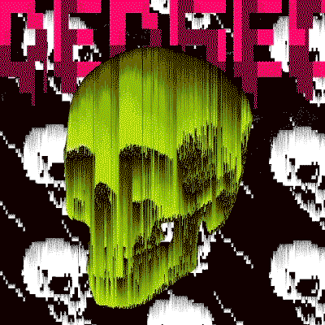
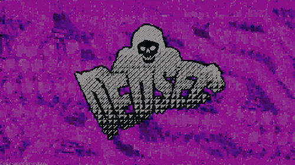
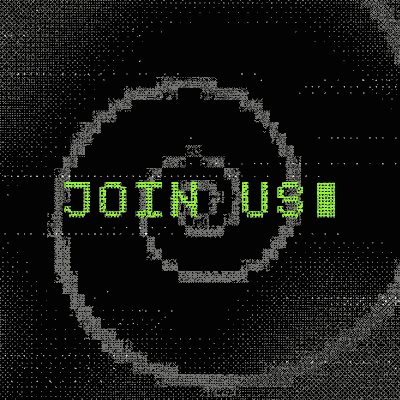
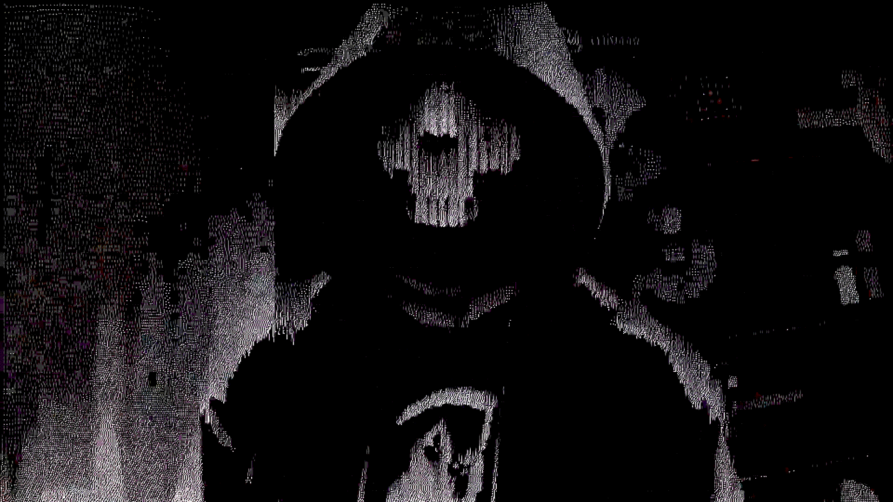

# DedSec // NetHack_OS

*"DedSec has given you the truth. Do what you will."*

<p align="center">
  
</p>

A fan-made hacker terminal **sim** in the DedSec spirit. You're a new DedSec operative —
dig up leads, crack ctOS surveillance nodes, flag dirty citizens, and run ops that build
to one big **exposé** — broadcast the truth, wake up the city.

## Status: WIP

This is an active work in progress. Icons are placeholders and getting reworked, more
ops/acts are coming, and sound design (SFX, more tracks) is still being built out. Expect
things to shift around.

## Play

**[Play it live](https://jo-gt.github.io/DedSec/)** — hosted on GitHub Pages, no install needed.

Or run it locally: just open `index.html` in any modern browser — no build step, no server needed.

```
# optional: serve it locally
python -m http.server 8080   # then visit http://localhost:8080
```

Boot → pick a handle → you're in.

<p align="center">
  
</p>

## How it works

- **[ terminal ]** — type `help`. Working commands: `ls`, `cd`, `cat`, `tree`, `pwd`,
  `decrypt`, `ssh`, `whoami`, `scan`, `ops`, `evidence`, `rep`, `neofetch`, `clear`, …
  (↑/↓ for command history)
- **[ ctOS_scanner ]** — click surveillance nodes to intercept their datastreams.
- **[ profiler ]** — live-mined citizen feed; flag one as evidence.
- **[ ops ]** — your mission board. Two acts, 11 operations, from onboarding to *KILL THE HIVE*.
- **[ exposé_studio ]** — drag your 3 evidence clips onto the timeline, then RENDER
  to broadcast the leak citywide and finish the campaign.

## The campaign (no spoilers, mostly)

**Act One**
1. **WAKE UP** – learn the deck.
2. **GHOST THE GRID** – recon, recover creds (`cat .secrets/keys.txt`), hack a node.
3. **PAPER TRAIL** – `decrypt` Blend's internal memo.
4. **THE NUDGE** – uncover PROJECT NUDGE and pull the dataset.
5. **GO LOUD** – assemble everything and broadcast the exposé.

**Act Two**
6. **AFTERSHOCK** – the exposé landed, but Blend's already rolling out PROJECT HIVE. Find their real network.
7. **TWO ROADS** – breach the mail relay or the contractor VPN proxy — or both.
8. **HR SHAKEDOWN** – pivot from the mail relay and pull personnel records.
9. **EYES IN THE WALLS** – pivot from the VPN proxy and steal the camera backbone's key.
10. **SALTED GROUND** – scan before you leap — Blend seeds its network with traps.
11. **KILL THE HIVE** – assemble Act Two's evidence and broadcast before the national rollout goes live.

## Screens

<p align="center">
  
  
  
  
</p>

## Project layout

```
index.html      markup + app shell
styles.css      DedSec glitch/neon theme (scanlines, CRT vignette)
js/fs.js        simulated filesystem
js/missions.js  operation definitions
js/apps.js      GUI apps + shared game state + win screen
js/commands.js  Linux-ish command interpreter
js/terminal.js  terminal I/O engine
js/boot.js      boot sequence, login, wiring
```

*expose, don't exploit. the people are not targets. when in doubt, make it public.*
